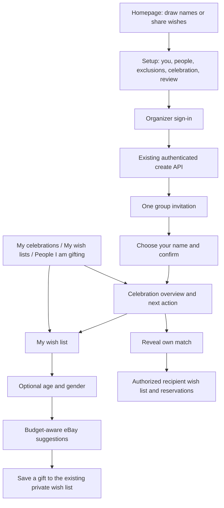

# Celebration journey rebuild — 2026-10-26

## Reference and scope

This release uses the observable DrawNames sequence: introduce the exchange, enter the organizer and people, configure exclusions and celebration details, review, invite, then manage wishes and gifts. Public references were rechecked at https://www.drawnames.com/how-to-draw-names and https://www.drawnames.com/features/wish-list-group, alongside the previously studied gift finder. No private competitor backend, code, artwork or account data was copied. No competitor groups, invitations or reservations were changed.

Hatpull retains its brand and licensed retailer integrations. The homepage, creation wizard, invitations, joining screen, celebration dashboard, wish-list headings and personal hubs share typography, spacing, cards, navigation and responsive controls. Original CSS gift artwork replaces the seasonal homepage hero. The separate name-picker pages retain their existing styling.

## Journey and architecture

- `lib/setup-flow.mjs` owns step order, roster construction, client validation and migration of old drafts. Wish-only groups skip exclusions. `Wizard` renders those stages and uses the existing authenticated `/api/create` contract. Server validation remains authoritative.
- `lib/wizard-draft.mjs` keeps the six-hour lifetime and query identity check. Version 2 drafts support sign-in recovery and review editing; older drafts map to the new stages without discarding their people or exclusions.
- `JourneyUI` provides headings and navigation. `StartHero` provides the homepage entry. Styling is scoped through `journey-surface`; retailer catalog styling remains distinct.
- `useCelebrations` loads private saved group references with at most four concurrent requests, discards outdated generations, clears stale rows on account changes, removes references to deleted groups, and exposes recoverable failures. It supplies the three hub views. Private state is not put into the public product cache.
- `celebrationNextStep` derives invitations, own wishes, reveal and recipient-list actions from authorized server state. It does not reveal a recipient name before the reveal or link to a server-hidden list.
- `useGroup`, database RPC permissions, participant tokens, organizer ownership, gift-save operations and the existing catalog cache are retained. There is no database migration or credential change in this release.
- Dashboard reveal errors now report failure and offer retry instead of displaying a successful reveal after a failed write.

## Verification

The automated suite covers setup route order, organizer participation, duplicate names, group size limits, valid dates and amounts, legacy draft migration, private next-action behavior, existing organizer access, catalog and wish-list operations. A production Next build is required before deployment.

Local browser QA used a disposable in-memory database loaded with the real schema/migrations and fictional Sam, Alex and Taylor. No production celebration was created or modified and no invitation was sent. Checks covered:

- Homepage through every setup stage, empty-name validation, review editing, reload recovery and the organizer sign-in gate.
- Two-person wish-only setup skipping exclusions.
- Organizer invitation, participant name confirmation and successful joining.
- Celebration next actions, shared navigation, own and other visible wish-list links.
- Automatic age/gender suggestions, the $25 item-price cap, one-tap eBay gift save and the resulting hub count.
- Desktop and 390px mobile views, with no horizontal page overflow on checked wish-list/dashboard screens.

## Limits and follow-up work

This is a rebuild of the core observable journey, not a claim of complete DrawNames feature or private architecture parity. Current wish lists belong to celebrations; a reusable standalone list with coordinated reservations across multiple celebrations needs a separate data model. Existing roster changes can redraw matches, and annual exclusions are still entered manually. Amazon remains browse-and-link until approved product API access is available. Age/gender suggestions are optional eBay keyword matches, not inferred identity or a guarantee of suitability.

## Rollback

Revert this app commit and redeploy; there is no schema rollback. Previous app versions ignore version 2 draft step semantics, so clear `hatpull.wizard` if rolling back during an in-progress setup. Existing groups, wish lists and saved retailer links are unchanged.
