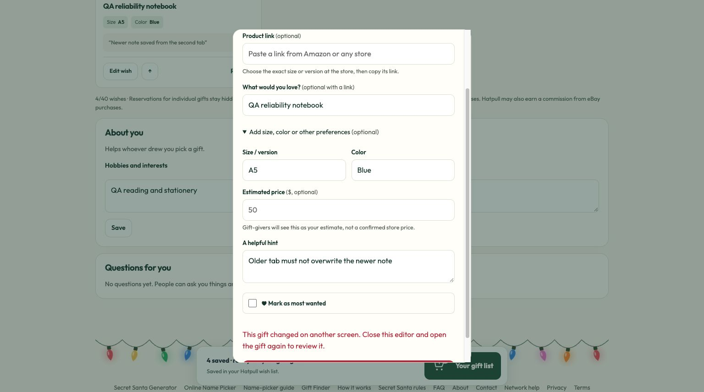

# Hatpull reliability audit — October 31, 2026

The tested changes prevent stale wish-list saves from erasing newer gifts, coalesce forced-refresh storms, reject malformed organizer requests before database writes, and keep the saving message accurate. The manual Remove action now uses the existing atomic gift-removal RPC so its reservation is cleared consistently.

## Scope and environment

- Local optimized Next.js production build, with the actual application catalog handler and caching/queue logic.
- Real isolated Supabase **Micro** database `codex-capacity-100k-20261029`, holding 100,000 fictional participants. No paid upgrade during this audit.
- Retailer responses are synthetic (100 ms provider delay). The test-only retailer route exists only in a separate temporary staging copy and is never committed or deployed.
- Load generators run on one local computer. This is not distributed Vercel capacity certification or 1,000 browsers rendering simultaneously.
- Existing QA production celebration remains intact. No database, celebration or account was deleted. No invitations, purchases or bulk retailer calls were made.

## Automated and functional checks

`npm test`: **115 passed, 0 failed**. This includes real SQL executed in PGlite, database access/visibility boundaries, organizer ownership, guest/child access, exact-budget filtering, unsafe-link rejection, cache isolation/expiry, duplicate additions, cart edit/remove/undo, demographic persistence, draw/reveal boundaries, redraw reservations, reminder deduplication/backoff, timeouts, cancellation and recovery.

New fault tests cover streamed body limits (including missing Content-Length), malformed JSON and field types, a stalled upload, invalid dates/budgets, the 200-person roster limit, account creation throttling, upstream errors, 100 forced refreshes, a later write during refresh, disposal, retailer throttling/malformed data, and 1,000 identical cached search requests.

The production dependency audit (`npm audit --omit=dev`) found **0 known vulnerabilities**. This is a point-in-time advisory check, not a guarantee of vulnerability absence.

The final production build passed. Twenty-one HTTP route/security checks passed: public pages, robots/sitemap, security headers, missing-auth denials, wrong methods, reminder access, health-value redaction and malformed catalog inputs.

Local browser testing confirmed manual gift creation with size/color/notes, interests persistence, reload persistence, accurate saving state, and the stale-editor conflict flow. Two tabs edited the same gift: the newer note survived, the old draft stayed open and an actionable conflict message appeared. No console warnings/errors were captured in that browser check.

## Real hosted database races

| Scenario | Verified result |
|---|---|
| 100 identical concurrent add attempts | Exactly one new gift |
| 20 distinct concurrent gift additions | All 20 retained |
| 50 editor saves from the same snapshot | One accepted, 49 explicit conflicts, gifts preserved |
| 19 people reserving the same shared gift | One winner, 18 `already_reserved` responses |
| Invalid token / another participant's profile | Both rejected |
| Gift owner's reservation view | Reservation remains hidden |

Expected authorization, conflict and reservation rejections are successful protective checks, not unexpected application failures.

## Sustained workload

Each run schedules 1,000 participant workflows across 50 groups, ramps them over 30 seconds, and spaces 15 actions by 20 seconds. Steps include search, detail, add, duplicate retry, edit, demographic save, reveal, recipient view, reservation, checked full-profile save, reload, conditional polling and sorting. Every workflow asserts persisted data and reservation privacy.

The repeat-save pass completed **1,000/1,000 workflows, 20,001 HTTP requests, 0 unexpected failures in 312 seconds**. Peak HTTP requests in flight was **29**; 1,000 active sessions do not imply 1,000 simultaneous requests. Endpoint p95s: state 95 ms, add/retry 117 ms, edit 125 ms, preferences 84 ms, reveal 85 ms, reserve 81 ms and checked save 95 ms. Cached synthetic search/detail p95s were 3 ms. Recovery search returned 24 items in 14 ms.

The fresh-insert pass also completed **1,000/1,000 workflows, 20,001 requests, 0 unexpected failures in 312 seconds**. It asserted 1,000 genuinely new additions before duplicate retries. Peak requests in flight was **67**. Real database p95s were: state 149 ms, add/retry 152 ms, edit 159 ms, preferences 202 ms, reveal 410 ms, reserve 89 ms, checked save 100 ms. Every endpoint met the selected p95 <2-second target. Recovery returned 24 items in 21 ms. Direct SQL confirmed 1,000 saved gifts with the correct notes/color, 1,000 saved profiles and 1,000 reservations. Combined sustained traffic: **40,002 requests**. See `fresh-soak-results.json` and `mixed-soak-results.json`.

## Important capacity limits

- These results **do not prove 100,000 simultaneous end-to-end users**, nor do they prove a burst of 1,000 fresh sign-ins or simultaneous cold searches.
- The earlier 1,000-user burst test (starts over 10 seconds) completed all 13,000 requests, but its p95 whole-journey duration was **18.412 seconds**, missing the chosen 10-second target. Its cold-search burst deliberately returned 429/503 backpressure. Those limits remain relevant.
- Real eBay/Amazon quotas, email delivery limits, new-account authentication throughput and Vercel scaling were not load-tested. The real retailer/user interface was functionally checked in the earlier end-to-end audit, not hammered at scale.
- A five-minute soak does not prove hours-long memory stability, regional failover or backup restoration. These remain separate release-readiness exercises for a large launch.
- Production security advisors reported no ERROR-level findings, but do flag intentionally callable, token-checked security-definer RPCs and denied-by-default tables. The leaked-password-protection setting remains a warning; the app's current UI uses Google/email sign-in. No security controls were disabled to obtain passing tests.

## Migration and rollback

`20261031190000_checked_profile_save.sql` adds a token/ownership-checked, row-locked compare-and-save RPC. The additive migration was applied and verified in both isolated and production databases before deploying the UI. It leaves the existing atomic RPCs and old API available for compatibility. The new UI uses the checked endpoint. Older already-open browser code needs a refresh to get that protection. Reverting the UI commit is safe while leaving the additive function installed; no data rollback or database deletion is necessary.

## Measurement corrections retained

An initial reservation fixture was private to the drawn recipient, so non-assigned contenders were correctly denied. The final race used a separately identified fictional shared-list fixture. Initial HTTP/soak harness parameter names were corrected to the application's supported `country` and `sort=low`; interrupted runs are retained as diagnostics and excluded from final capacity claims. Repeated-save and fresh-insert results are separated rather than counting an idempotent retry as a new insertion.

Detailed logs, JSON metrics and the harnesses are saved with the local audit artifacts. They contain no credentials or real participant data.

Responsive-layout note: the earlier end-to-end audit verified a 390 px mobile flow. This audit verified the revised editor on desktop; the attempted Chrome viewport override did not change the measured width, so that attempt is not counted as a new mobile pass.
